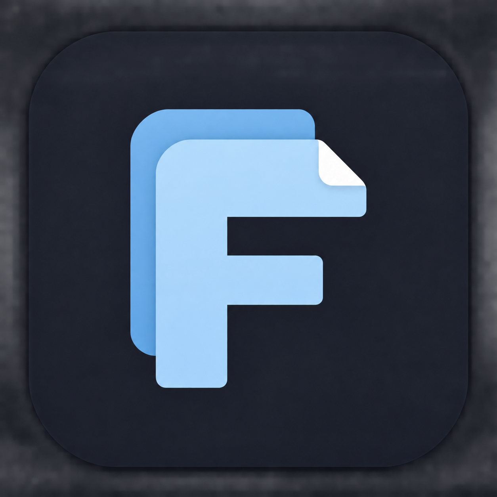
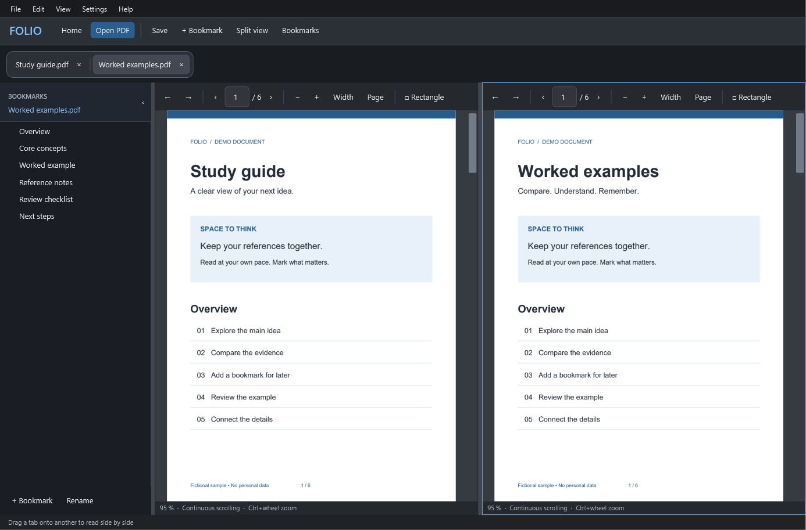
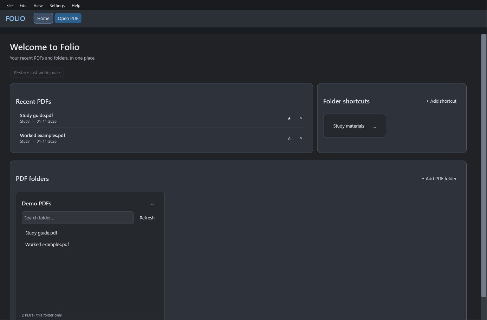
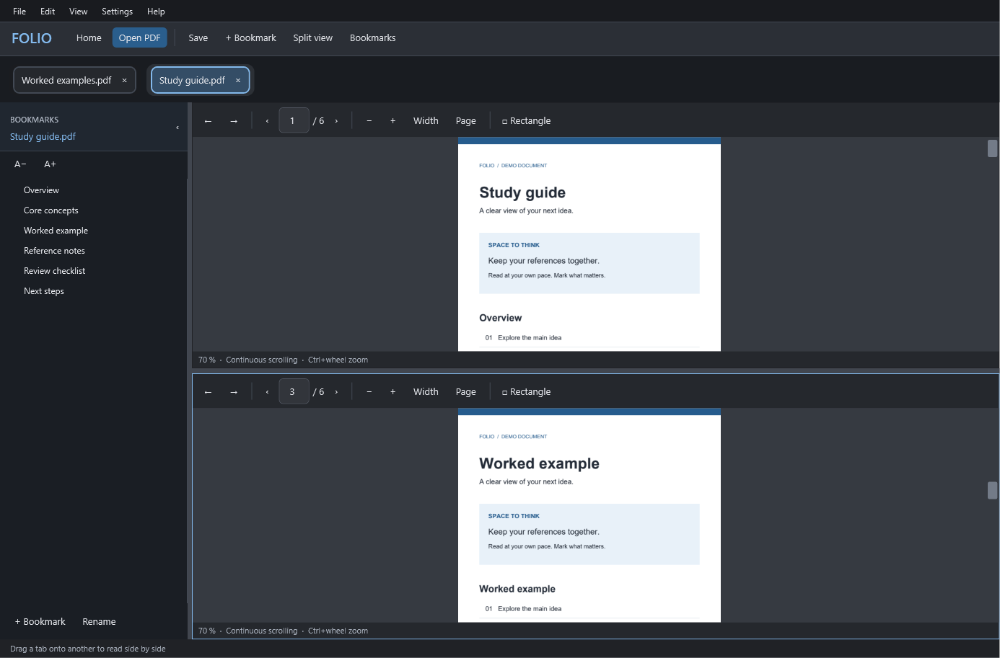
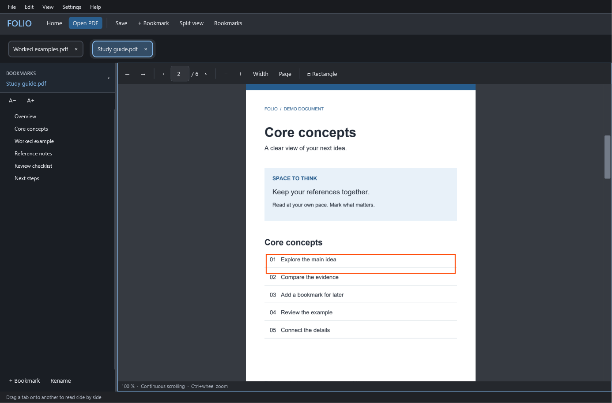

<p align="center"></p>
<h1 align="center">Folio</h1>
<p align="center"><strong>Your PDFs, together.</strong><br>A focused Windows workspace for reading, comparing and keeping track of PDFs.</p>
<p align="center"><a href="https://github.com/AidedPolecat6/Folio/releases/latest">Download for Windows</a> · <a href="docs/USER-GUIDE.md">User guide</a> · <a href="https://github.com/AidedPolecat6/Folio/issues">Report an issue</a></p>



## Less window switching. More understanding.

Keep a study guide beside worked examples. Bookmark the useful bits. Compare distant pages of the same document. Folio gives your PDFs a home without turning reading into window management.

- **Tabs that stay loaded.** Switch documents without reopening them.
- **Tab groups, side by side.** Drop a tab onto another to create a shared workspace. Drag dividers to resize; detach tabs when you want them separate again.
- **Two views of one PDF.** `Ctrl+Shift+S` creates independent top/bottom views with shared edits.
- **Read your way.** Continuous scrolling or one page at a time, with adjustable scroll speed and independent zoom in every view.
- **Bookmarks that travel with the PDF.** Add, rename, reorder, nest and delete bookmarks. `Ctrl+B` bookmarks your current page.
- **Mark what matters.** Draw rectangles, choose color and thickness, then move or resize them using eight handles. Undo and redo are included.
- **A useful home screen.** Recent PDFs, pinned favorites, folder shortcuts and searchable PDF-folder panels.
- **A calm dark interface.** Distinct toolbars, a dedicated bookmark panel, helpful tooltips and an in-app getting-started guide (`F1`). PDF pages retain their original colors.
- **Local by design.** No account, subscriptions or cloud upload. Your documents remain on your computer.

## Install

1. Download **Folio-Setup-…-win-x64.exe** from [Releases](https://github.com/AidedPolecat6/Folio/releases/latest).
2. Follow the wizard. Choose your installation folder and optional desktop shortcut.
3. Start Folio. To make it your PDF default, use the wizard's optional Windows Settings link and confirm the choice there.

The default location is `%LOCALAPPDATA%\Programs\Folio`. Installation is per-user and normally requires no administrator access. The .NET runtime is included. Windows 10/11 x64 is supported; other platforms are not packaged.

A **portable ZIP** is also available: extract the entire folder and run `Folio.exe`. Settings are still stored under `%LOCALAPPDATA%\Folio`.

This is an **early release**, and the installer is currently unsigned. Windows may display an unknown-publisher/SmartScreen notice. Release checksums are provided in `SHA256SUMS.txt`.

## A closer look

### New in 0.5.0
- Clearer PDF tabs, with one shared frame around grouped tabs.
- Bookmark text wraps automatically; A− / A+ adjusts its size and remembers your choice.
- Horizontal trackpad scrolling and blue outlines around PDF link areas (display-only).
- A cleaner Home screen with responsive side-by-side sections, recent-file dividers, shorter folder labels and search placeholders.
- Fully dark context menus, fixing the white strip in folder options.

### Start where you left off


### Compare two places in one document


### Organize and annotate


*All screenshots use generated, fictional documents and demo paths. No personal PDFs, names or browsing history are included.*

## Handy shortcuts

| Shortcut | Action |
|---|---|
| `Ctrl+O` | Open PDFs |
| `Ctrl+Tab` / `Ctrl+Shift+Tab` | Cycle PDF tabs within a group, or standalone workspaces |
| `Ctrl+B` | Bookmark the current page |
| `Ctrl+Shift+S` | Toggle top/bottom split |
| `Ctrl+S` | Save (Save As is in the File menu) |
| `Ctrl+Z` / `Ctrl+Y` | Undo / redo |
| `Ctrl+F` / `Ctrl+G` | Find text / go to page |
| `Ctrl+W` / `Ctrl+Shift+T` | Close / reopen a tab |
| `Ctrl+wheel` | Zoom |
| `F1` | Getting started and shortcuts |

## Current scope

Folio edits **bookmarks and rectangle annotations**, not existing text or images. Text selection/copying, OCR, highlights, freehand annotations, page management and password-protected PDFs are not implemented. Search locates matching pages rather than highlighting each match. Editing a digitally signed PDF invalidates its signature.

Closing modified PDFs prompts to save. Writes use a temporary file and atomic replacement, with detection of external changes. There is no crash recovery for unsaved edits yet. Undo retains up to 20 full-document snapshots; large editing workloads can consume more memory. The renderer caches roughly 64 MB per document plus visible images.

## Build and contribute

Built with **C# / .NET 8 / WPF**, **PDFium** for rendering, and **PDFsharp** for editing.

```powershell
dotnet build -c Release
Start-Process .\bin\Release\net8.0-windows\win-x64\Folio.exe --self-test -Wait
Get-Content "$env:TEMP\opencode\folio-selftest.txt"
```

Tests generate temporary PDFs and isolated profiles. They cover links, rendering, caching, bookmark persistence, annotations, undo, grouped/split views, workspace restore, recent files, scroll settings and virtualized continuous layouts.

To build the self-contained release and installer, install [Inno Setup 6.7+](https://jrsoftware.org/isdl.php), then run:

```powershell
.\scripts\Build-Release.ps1 -Iscc "C:\Program Files (x86)\Inno Setup 6\ISCC.exe"
```

To recreate the privacy-safe screenshots:

```powershell
Start-Process .\bin\Release\net8.0-windows\win-x64\Folio.exe -ArgumentList '--demo-capture docs\images' -Wait
```

Bug reports are welcome. Include your Folio version, Windows version, steps to reproduce and whether it affects a small local PDF. Please remove private content before attaching sample documents or screenshots.

Errors are logged locally in `%LOCALAPPDATA%\Folio\Logs\errors.log`; use **Help → Open error log folder** to find it. Entries include time, version, operation and exception details. The log rotates at 1 MB and keeps one previous file (`errors.log.old`). Nothing is uploaded automatically. Error messages can include local file paths, so review logs before sharing them.

## License

Folio is [MIT licensed](LICENSE). PDFium, PDFsharp and the bundled runtime retain their upstream licenses; see [third-party notices](THIRD-PARTY-NOTICES.md) and [`licenses/`](licenses/).
